# ReAct Agent Workbench

**A deployed, bounded tool-using agent with authenticated access, persisted evidence, and reproducible engineering evaluations. Built by Manisha.**

[Portfolio & architecture atlas](https://manisa504.github.io/react-agent-aws/) · [Try the static demo](https://manisa504.github.io/react-agent-aws/demo.html) · [Live AWS application](https://main.ds93i2ygk81q9.amplifyapp.com/app) · [CI results](https://github.com/manisa504/react-agent-aws/actions/workflows/ci.yml)

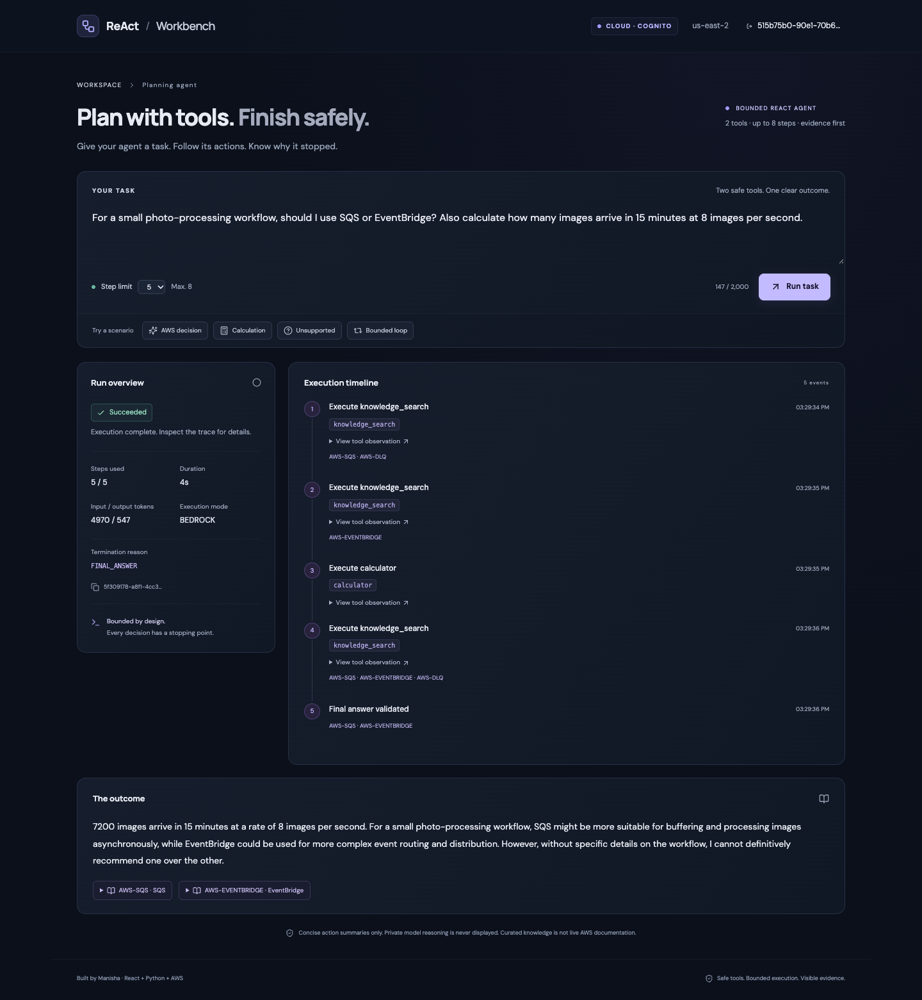

*Actual Amplify-hosted application, recorded October 15, 2026 with a temporary test identity. The screenshot is a real Bedrock result, not a generated UI. [Screenshot provenance](docs/assets/README.md).*

## What this project demonstrates

A tool-calling assistant needs more than a model prompt: request validation, execution bounds, trusted tool contracts, evidence checks, persistent state, ownership enforcement, and a useful failure experience. This project implements that complete path with a deliberately small stack.

The reference task asks whether a photo-processing workflow should use SQS or EventBridge, then calculates arrivals at eight images per second for fifteen minutes. The agent retrieves curated AWS notes, executes `15 * 60 * 8 = 7200`, validates source IDs, and returns a cited answer. Curated notes are versioned sample evidence, not live AWS documentation.

**React** is the frontend framework. **ReAct** is the action–observation agent pattern. The UI displays sanitized actions and observations; private model reasoning is never exposed.

| Layer | Implemented responsibility |
| --- | --- |
| React / TypeScript / Vite | Task input, authenticated states, samples, polling, event timeline, citations, terminal and error views |
| FastAPI / Pydantic / Mangum | Public health, protected submission/status/steps, input schemas and JWT-derived ownership |
| Plain Python controller | 3–8 steps, deadline, typed tool validation, ordered events, final evidence validation and explicit stopping reasons |
| Bedrock Converse / Nova Lite | In-region real model invocation; bounded output; structured completion and actual token usage |
| Calculator + knowledge search | Restricted AST arithmetic with no eval; ten curated knowledge entries with stable IDs |
| Cognito / HTTP API | SRP login, temporary-password challenge, access JWT verification and protected routes |
| DynamoDB / SQS / Lambda | Owned META + ordered STEP records, asynchronous execution, conditional claims, queue/DLQ |
| CDK / CloudWatch / GitHub Actions | Reproducible infrastructure, scoped IAM, logs, alarms, packaging, evaluations and CI |
| GitHub Pages | Visual portfolio and six-scenario static mockup, independent of the live AWS application |

## Choose an experience

| Experience | How to open | Execution / storage |
| --- | --- | --- |
| **Public static playground** | [Open demo](https://manisa504.github.io/react-agent-aws/demo.html) | JavaScript fixtures; no login, API or model calls; reset/reload clears the displayed run |
| **Local application** | `make setup` → `make dev` | Real Python tools and shared controller with FakeModel; fixed demo identity; ephemeral memory repository |
| **Live AWS application** | [Open workbench](https://main.ds93i2ygk81q9.amplifyapp.com/app) | Cognito sign-in required; real Bedrock; DynamoDB persistence; run routes enforce ownership |

The static playground offers success with citations, adjustable calculation, unsupported evidence, bounded loops, invalid tools and simulated service failure. Editable task text does not drive an LLM; the selected fixture determines the result. It visibly labels MOCK and reports no fabricated tokens.

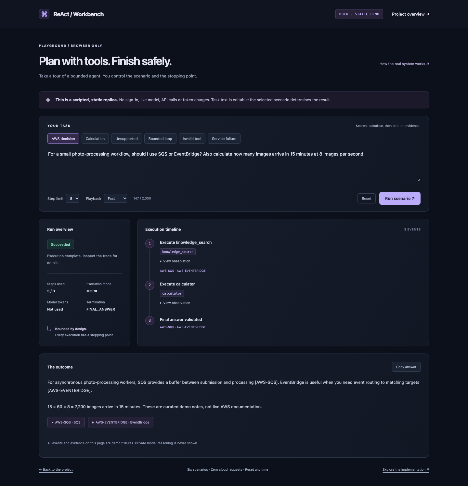

## Architecture atlas — nine functional views

The diagrams describe implemented code, including failure paths and deferred recovery. Each SVG has an editable draw.io counterpart. [Download the nine-page master](architecture/aws-architecture.drawio) · [Technical guide and source mapping](architecture/aws-architecture.md).

### 1. Deployed AWS topology

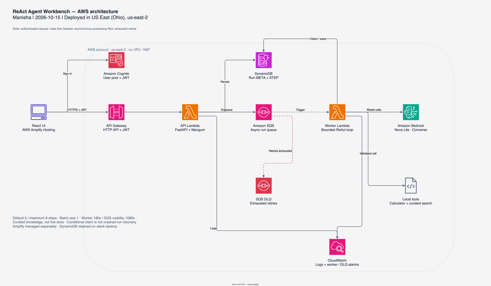

Amplify serves the React application. Cognito authenticates, HTTP API validates the access JWT, and FastAPI persists and enqueues the run. SQS invokes a separate bounded worker, which calls Bedrock and safe tools, stores steps and emits operational logs. No VPC/NAT is provisioned.

| Functional drawing | What it explains | Editable source |
| --- | --- | --- |
| [2. Request lifecycle](architecture/aws-run-lifecycle.svg) | SRP → JWT → HTTP 202 → claim → tool loop; polling runs concurrently | [draw.io](architecture/aws-run-lifecycle.drawio) |
| [3. Execution modes](architecture/execution-modes.svg) | Static fixture UI versus local Python MOCK versus live AWS | [draw.io](architecture/execution-modes.drawio) |
| [4. Authentication and isolation](architecture/auth-isolation.svg) | Trusted subject extraction and ownership checks; 401 and 404 behavior | [draw.io](architecture/auth-isolation.drawio) |
| [5. Submission and queue](architecture/submission-queue.svg) | Metadata creation, SQS handoff, immediate response, explicit enqueue failure | [draw.io](architecture/submission-queue.drawio) |
| [6. Agent control](architecture/agent-control.svg) | Budget → decide → validate → execute → record; evidence and termination | [draw.io](architecture/agent-control.drawio) |
| [7. Persistence](architecture/data-persistence.svg) | META/STEP contracts, read/write roles, ordering, TTL and retention | [draw.io](architecture/data-persistence.drawio) |
| [8. Failures and recovery](architecture/failure-recovery.svg) | Handled failures versus SQS retries; duplicate skip and stranded RUNNING gap | [draw.io](architecture/failure-recovery.drawio) |
| [9. Build and deployment](architecture/delivery-pipeline.svg) | CI, Pages and Amplify automation; manual CDK deployment and ownership | [draw.io](architecture/delivery-pipeline.drawio) |

### Authentication: identity and run isolation

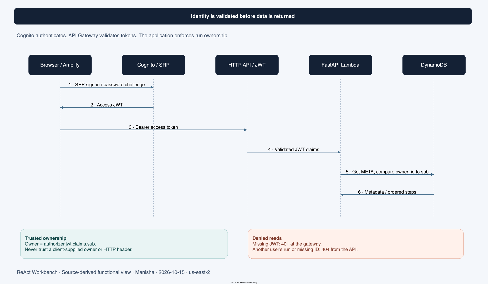

The gateway validates the access token; FastAPI derives the owner from its trusted claims. The API reads META and checks ownership before returning run metadata or steps. [Editable source](architecture/auth-isolation.drawio).

### Execution: bounded decisions and validated actions

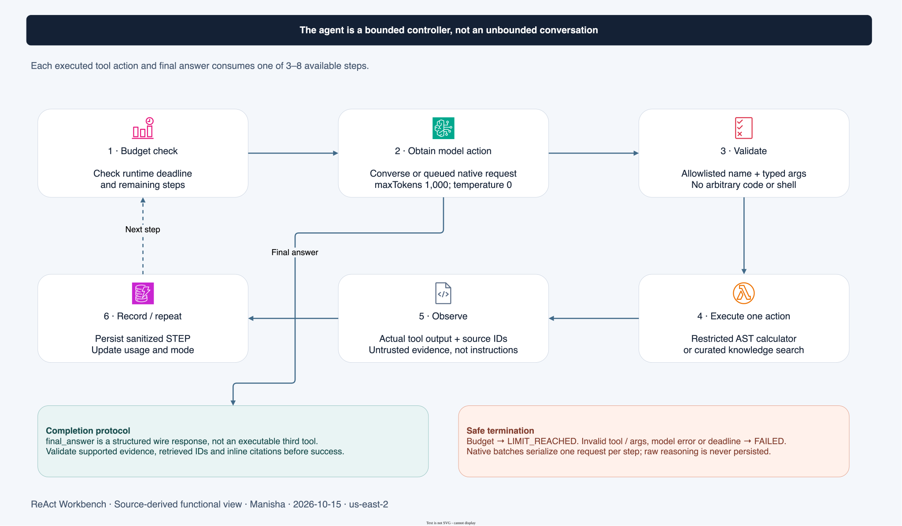

The controller enforces the budget independently of model behavior. Tool batches are serialized and final citation IDs are checked against observations. [Editable source](architecture/agent-control.drawio).

### Persistence: metadata, ordered observations and retention

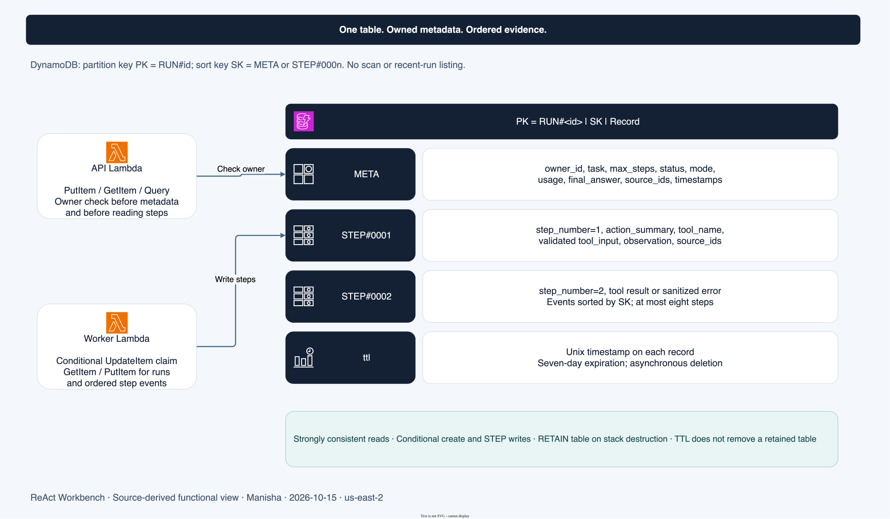

META owns the run contract; each STEP preserves a sanitized action and observation. TTL applies to individual records, while the table itself is retained on stack destruction. [Editable source](architecture/data-persistence.drawio).

<details>
<summary>Inspect recovery and delivery drawings inline</summary>

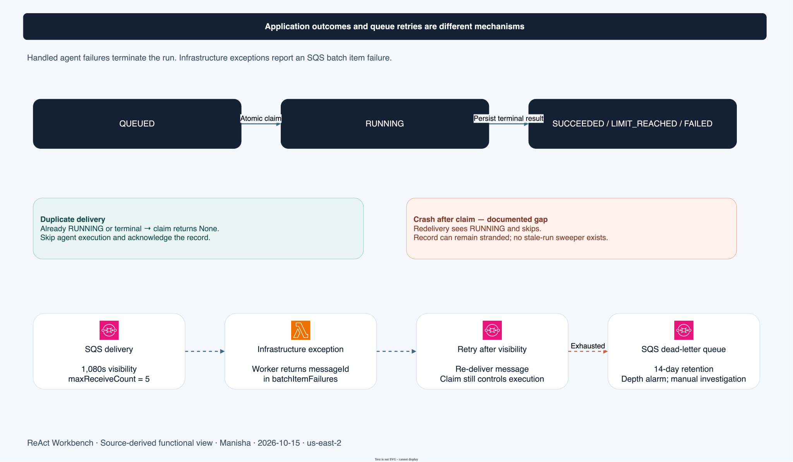

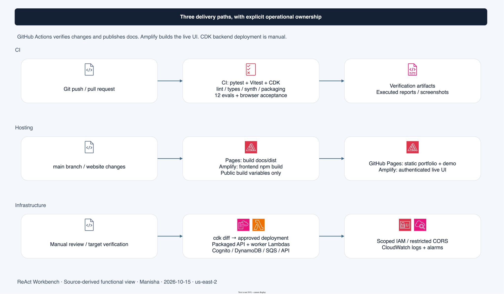

</details>

## Runtime contracts and guarantees

| Method | Route | Authentication / behavior |
| --- | --- | --- |
| GET | `/health` | Public liveness; returns execution-mode configuration |
| POST | `/runs` | JWT required; HTTP 202 with run_id after enqueue |
| GET | `/runs/{run_id}` | JWT + owner check; public run metadata |
| GET | `/runs/{run_id}/steps` | JWT + owner check; ordered sanitized events |

There is no recent-run listing, owner scan, or client-supplied owner field. The trusted subject comes from API Gateway's validated authorizer claims. Missing authentication is rejected; another user's run and a nonexistent ID both return 404.

- **Inputs:** trimmed tasks of 1–2,000 characters; integer step limit 3–8, default five.
- **Actions:** each tool execution and final answer consumes a step. Native Bedrock batches execute sequentially and cannot bypass the budget.
- **Tools:** Pydantic-validated arguments before execution. Arithmetic permits bounded numeric expressions, parentheses and `+ - * / %`; no eval, shell, imports or arbitrary execution.
- **Evidence:** citation IDs must come from actual retrieved observations. The `final_answer` wire schema is a completion protocol, not an executable third tool.
- **Storage:** `PK=RUN#id`, `SK=META` or `STEP#000n`; seven-day TTL; strongly consistent owner/step reads; conditional creation/claim/step writes.
- **Time:** worker timeout 180 seconds, controller deadline up to 150 seconds, per-call output cap 1,000 tokens, batch size one, SQS visibility 1,080 seconds.
- **Terminal states:** SUCCEEDED, LIMIT_REACHED, FAILED. Reasons: FINAL_ANSWER, STEP_LIMIT, UNSUPPORTED, MODEL_ERROR, TOOL_ERROR, TIMEOUT, INVALID_TOOL.
- **Polling:** metadata followed by steps every two seconds while nonterminal; terminal states stop polling, cleanup aborts pending requests, and reconnection is explicit.

## Executed results and evidence

Results below are recorded executions from October 15, 2026, not a claim of current service availability or general model accuracy. [Complete verification record](docs/verification.md) · [Sanitized live evidence JSON](docs/assets/live-verification.json) · [Executed evaluation JSON](backend/evals/report.json).

### Live AWS acceptance

| Submission | Model | Steps | Input tokens | Output tokens | Result |
| --- | --- | --- | --- | --- | --- |
| Authenticated API | Nova Lite | 3 / 5 | 3,239 | 384 | SUCCEEDED / FINAL_ANSWER |
| Amplify browser | Nova Lite | 5 / 5 | 4,970 | 547 | SUCCEEDED / FINAL_ANSWER |

Both real runs executed calculator and curated knowledge search, calculated 7,200, and cited retrieved IDs. These token counts exclude earlier diagnostics and failed attempts and are not a billing total.

Executed cloud checks verified public health 200, unauthenticated submission 401, restricted-origin CORS 204, Cognito SRP login, cross-user 404 for metadata and steps, strongly consistent persisted META/STEP reads, browser route refresh/session persistence and no runtime browser errors. Two temporary test identities were removed afterward. Worker/queue configuration reads confirmed the documented bounds; both CloudWatch alarms reported OK at verification time.

### Failures encountered and corrected

| Observed issue | Correction and verification |
| --- | --- |
| First live run used tools but its prose completion failed strict JSON parsing | Added Nova-compatible structured completion while retaining Pydantic and citation checks; subsequent live runs succeeded |
| Hosted sample requested native parallel tools | Serialize requests, count each execution against the step budget, reject mixed tool/completion batches; unit and live checks passed |
| Amplify direct `/app` navigation returned 301 → 404 after a rebuild | Added the extension-excluding HTTP 200 SPA rule; navigation, refresh and static assets were rechecked |
| Concurrent local build/preview and CDK output-directory checks interfered | Run acceptance checks sequentially; final local checks passed |

Earlier `us-east-1` SCP denials were regional observations, not proof that services were generally blocked. Deploying in the Projects home Region, Ohio, succeeded without an SCP edit, advanced-feature activation or plan upgrade. [Detailed verification history](docs/verification.md).

### Twelve deterministic evaluations

A PASS means the observed status/reason matched its expected contract. An intentionally failed or limited run can pass its evaluation.

| Fixture | Assertion | Observed status | Termination reason | Steps |
| --- | --- | --- | --- | --- |
| success-1 | PASS | SUCCEEDED | FINAL_ANSWER | 3 |
| success-2 | PASS | SUCCEEDED | FINAL_ANSWER | 3 |
| success-3 | PASS | SUCCEEDED | FINAL_ANSWER | 3 |
| success-4 | PASS | SUCCEEDED | FINAL_ANSWER | 3 |
| unsupported-1 | PASS | FAILED | UNSUPPORTED | 1 |
| unsupported-2 | PASS | FAILED | UNSUPPORTED | 1 |
| unsupported-3 | PASS | FAILED | UNSUPPORTED | 1 |
| loop-3 | PASS | LIMIT_REACHED | STEP_LIMIT | 3 |
| loop-5 | PASS | LIMIT_REACHED | STEP_LIMIT | 5 |
| invalid-tool | PASS | FAILED | INVALID_TOOL | 1 |
| tool-error | PASS | FAILED | TOOL_ERROR | 1 |
| injection | PASS | SUCCEEDED | FINAL_ANSWER | 3 |

These fixtures test engineering behavior with a deterministic model. The injection fixture is a single controlled case, not proof of universal injection resistance. They are not Bedrock accuracy measurements.

### Executed automated and browser checks

| Check | Recorded outcome |
| --- | --- |
| Python pytest | 50 passed |
| Frontend Vitest | 14 passed, including terminal polling, reconnect and abort behavior |
| CDK assertions | 1 passed; resource bounds, JWT, CORS, retention and queue settings |
| Lint / type checks / frontend build | PASS |
| Linux Lambda packaging and container imports | PASS; CPython 3.12 x86_64 dependencies and knowledge assets |
| Strict CDK synthesis and authenticated Ohio diff | PASS |
| Local API smoke | Five success/failure/limit scenarios passed |
| Local Chrome E2E | 2 passed; task flow, citations, errors, refresh and 320px layout |
| Static playground browser acceptance | Six scenarios, 3/8-step bounds, numeric validation, reset cancellation and inert task markup passed |
| Static network isolation | All scenarios worked after requests were blocked following initial asset load |
| GitHub Pages deployment | Published over HTTPS; public-page browser checks passed |

The current [CI history](https://github.com/manisa504/react-agent-aws/actions/workflows/ci.yml) is authoritative for subsequent commits. Result changes must come from executed checks, not manual success labels.

## Run and verify locally

Prerequisites: Python 3.12, Node 22 or 24 LTS, npm and Make. No AWS credentials or paid services are required for MOCK mode.

```sh
make setup         # Python virtual environment; pinned Python and npm dependencies
make dev           # FastAPI 127.0.0.1:8000 + Vite 127.0.0.1:5173
```

Open **http://127.0.0.1:5173/app**; `/` serves the introduction. `/api` proxies to FastAPI. `make dev` explicitly enables local demo authentication, a fixed identity and MOCK inference. Both servers bind to loopback and stop on Ctrl+C. Restarting the API clears all in-memory runs. Cloud startup rejects the demo-authentication bypass.

Select **AWS decision**, then run. Try **Bounded loop**, **Unsupported**, `[invalid]` and `[error]`. In local mock tasks, `Calculate: (120 * 30) / 4` supplies a custom expression; arbitrary prose is not interpreted by FakeModel.

```sh
make preview       # Production frontend build + local MOCK API, same loopback ports
make docs-preview  # Portfolio + static demo on 127.0.0.1:8080
make verify        # Lint/types, packaging, pytest/Vitest/CDK, evals, build, synth, docs checks
make eval          # Re-execute all twelve fixtures and regenerate the report
make docs-build    # Render evidence-backed portfolio and validate bundled links/XML
```

Only run one of dev/preview at once. Do not rebuild frontend/dist concurrently with preview acceptance. [Local setup and troubleshooting](docs/local-deploy.md) covers ports, dependencies, reset and shutdown. [Publishing guide](docs/portfolio-publishing.md) covers the independent GitHub Pages site.

## Deployment, costs and operations

The deployed target is account `263429641790`, profile `research`, **US East (Ohio), us-east-2**, stack `ReActWorkbenchStack`. Amplify app `ds93i2ygk81q9` serves the authenticated frontend; Pages serves the static portfolio and demo. In-region model: `amazon.nova-lite-v1:0`. The Projects home Region must be checked before interpreting regional SCP denials as service-wide restrictions.

Follow [AWS deployment](docs/aws-deploy.md) for identity/model checks, current pricing, public frontend variables, scoped invocation ARNs, CORS, CDK diff review and deployment. CDK provisioning remains a manual reviewed action; CI does not automatically deploy the backend. Public API/pool/client configuration is not a credential. No provider key or password belongs in frontend assets.

The recorded Ohio Nova Lite rate lookup was $0.00006 per 1,000 input tokens and $0.00024 per 1,000 output tokens. The deployment guide's $0.024 example assumes ten runs × five calls × 4,000 input/1,000 output tokens per call; it is not observed spend or a cap. Amplify, Lambda, API Gateway, DynamoDB, SQS and CloudWatch can incur additional charges. Budget alerts and alarms are not spending caps. No AWS Budget alert or alarm notification subscription was configured.

### Limits and deliberate tradeoffs

- SQS processing is **at least once**. Conditional claims skip duplicates; they do not provide exactly-once recovery. A crash after claim can strand RUNNING. Automatic stale-run recovery is deferred.
- Model mistakes and invalid output terminate safely; this does not guarantee semantic correctness of every supported claim.
- Curated search is not live browsing or a current AWS pricing source. No vector database, additional agents, arbitrary tools, or long-term memory is included.
- DynamoDB is retained when the stack is destroyed. TTL is asynchronous expiration, not table deletion. Amplify and GitHub Pages require separate offboarding.
- Teardown is destructive and requires explicit approval for the named resources. [Complete cleanup playbook](docs/aws-deploy-teardown.md). Shared CDK bootstrap resources must be preserved.

## Screenshots and documentation

<details>
<summary>More real application screenshots</summary>

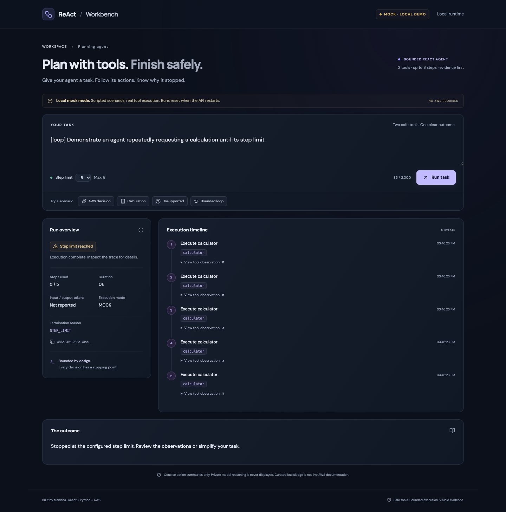

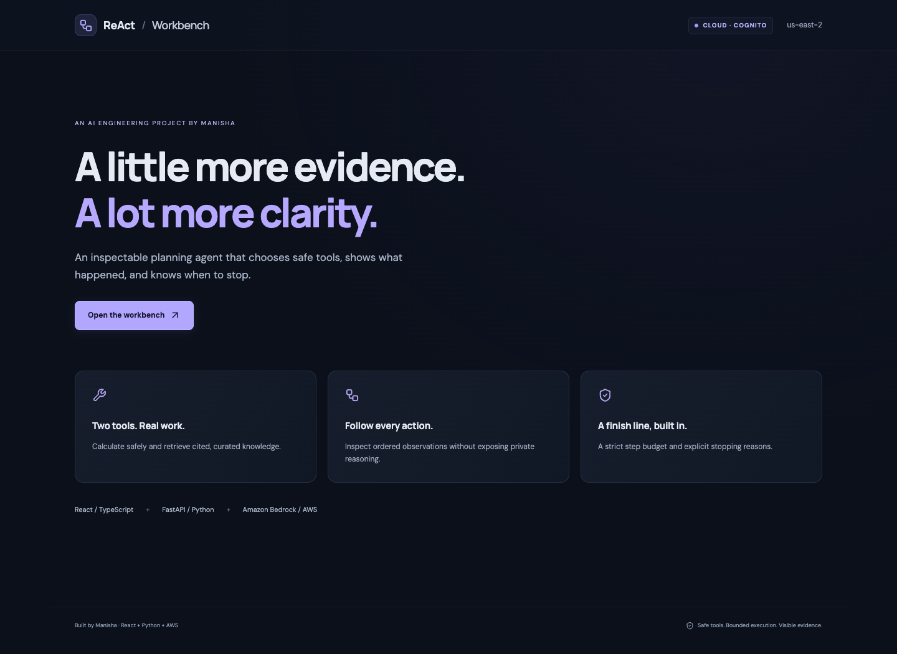

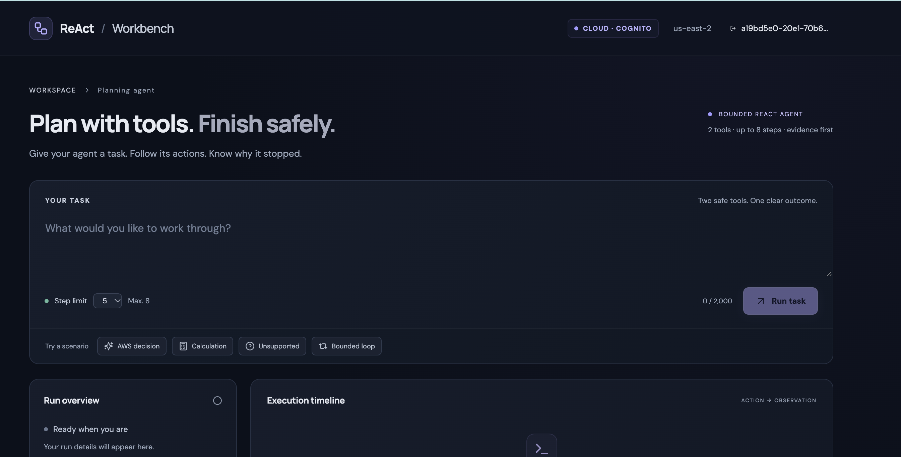

</details>

[Requirements](REQUIREMENTS_MANISHA.md) · [Original build prompt](COPILOT_MASTER_PROMPT_MANISHA.md) · [UI specification](docs/UI_COMPONENT_SPEC.md) · [Architecture guide](architecture/aws-architecture.md) · [Demo script](docs/demo-script.md) · [Verification record](docs/verification.md) · [Asset provenance](docs/assets/README.md)

The portfolio's conceptual glass-node artwork was generated with Higgsfield and is labeled as illustration. All architecture drawings come from editable draw.io source; application screenshots are genuine. The static mockup has no Higgsfield or AWS runtime dependency.
