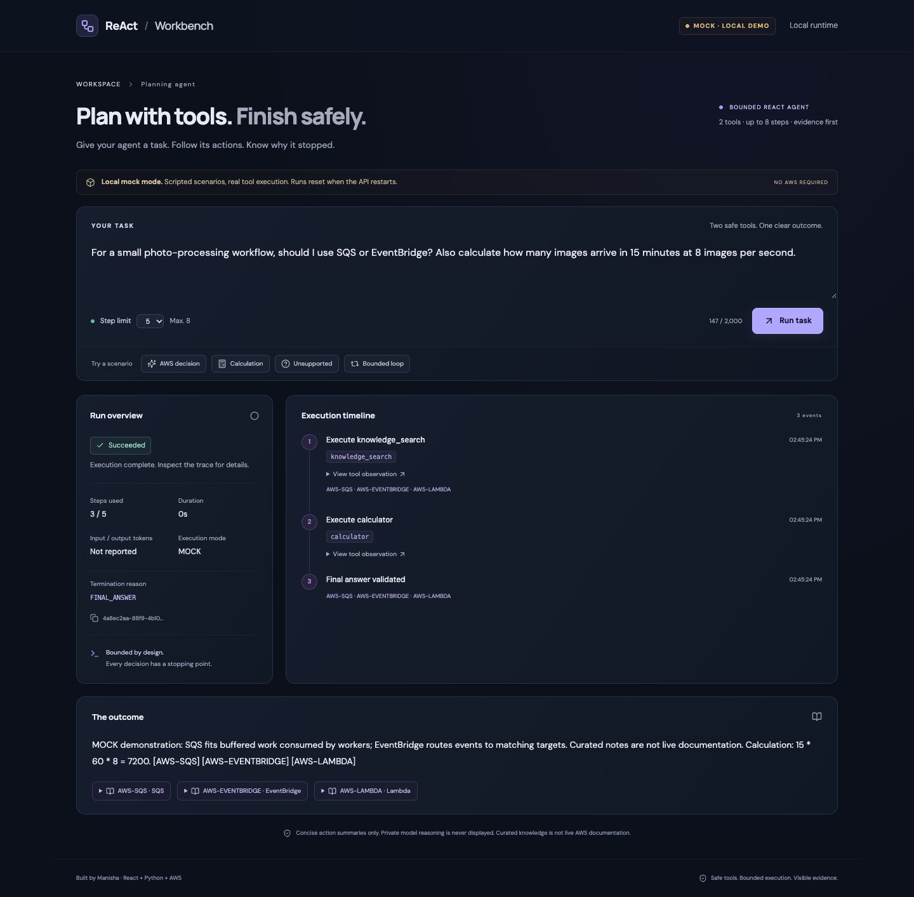
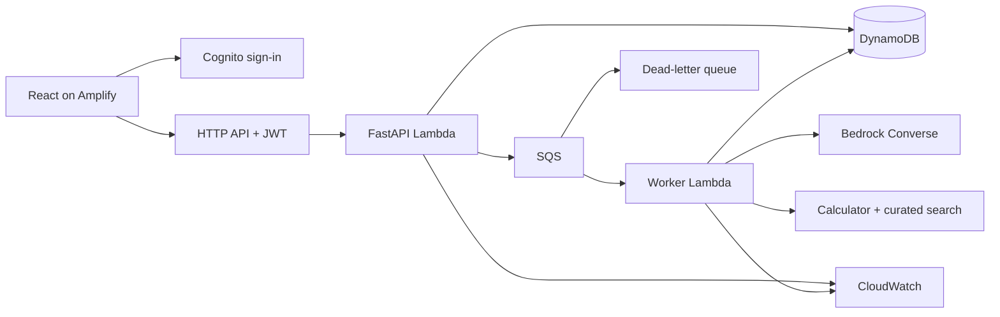

# ReAct Agent Workbench

[Source repository](https://github.com/manisa504/react-agent-aws) · [Automated checks](https://github.com/manisa504/react-agent-aws/actions/workflows/ci.yml)

Tool-calling assistants can repeat actions or give answers without evidence. Manisha's workbench demonstrates an agent with two safe tools, an inspectable action trace, and an enforced stopping point.

**React** is the UI framework. **ReAct** is the model/tool action-and-observation pattern. Private chain-of-thought is never displayed.

**Status:** implemented and verified locally in deterministic MOCK mode. AWS infrastructure is synthesized and tested. GitHub upload and AWS account authentication are verified; live deployment is blocked by organization policy denials for Amplify and CloudFormation in the selected region. A live Bedrock run and public AWS URL remain unverified. See [verification notes](docs/verification.md).



*Actual local application; scripted mock inference, real calculator and knowledge-search execution. This screenshot does not represent an AWS deployment.*

## Run locally

Requirements: Python 3.12, Node.js 22 or 24 LTS, npm, and Make. No AWS account or credentials are needed for local execution.

```sh
cd react-agent-aws
make setup
make dev
```

Open **http://127.0.0.1:5173/app**. The public introduction is at `/`; API documentation is at **http://127.0.0.1:8000/docs**. `make dev` explicitly enables loopback-only demo authentication and MOCK inference. Ctrl+C stops both servers. In-memory runs disappear when the API restarts.

Click **AWS decision**, then **Run task**. The agent executes knowledge search, calculates `15 * 60 * 8 = 7200`, then returns a cited answer. Try **Bounded loop** and **Unsupported** to inspect deterministic stopping. The mock adapter is scripted; it does not interpret arbitrary natural-language tasks. `Calculate: (120 * 30) / 4` supplies a custom arithmetic expression in mock scenarios. `[invalid]` and `[error]` demonstrate rejection and failure.

```sh
make preview       # Build and serve the production frontend + local API, same ports
make docs-preview  # Independent showcase at http://127.0.0.1:8080
```

Only run one of `dev` and `preview` at a time. See [local deployment](docs/local-deploy.md) for shutdown, reset, and troubleshooting.

## Verification

```sh
make lint          # Python lint, frontend lint/types, infrastructure types
make package       # Linux x86_64 CPython 3.12 Lambda dependencies, even on macOS
make test          # pytest, Vitest, CDK assertions; packages Lambda assets first
make eval          # Execute twelve fixtures; writes backend/evals/report.json
make build         # Frontend production build
make synth         # Package Lambdas and synthesize CDK without account lookups
make docs-build    # Static bundle, local links, draw.io/SVG XML checks
make verify        # All local automated gates, in dependency order
```

With `make dev` running: `.venv/bin/python scripts/local_smoke.py` tests the API via the frontend proxy. `cd frontend && npm run test:e2e` exercises Chrome, produces genuine screenshots, and checks the 320px layout. Set `CHROME_PATH` when Chrome is installed elsewhere. CI installs Chromium instead.

[Evaluation report](backend/evals/report.json): twelve deterministic MOCK fixtures, not a benchmark of Bedrock quality. See [verification notes](docs/verification.md) for executed results and limits.

## Architecture


[Editable draw.io source](architecture/aws-architecture.drawio) · [Architecture guide](architecture/aws-architecture.md) · [Presentation site](docs/index.html)



Submission returns HTTP 202; the UI polls every two seconds until terminal. Local background execution and the SQS worker use the same controller. Each model decision counts toward the 3–8 step budget, including a final answer. Tools use typed arguments. Arithmetic accepts bounded numeric expressions, parentheses and `+ - * / %`, with no `eval`. Search reads ten curated entries; it is not live AWS documentation. Citation IDs must come from actual retrieved observations.

Cloud reads use a JWT-derived owner, never request-supplied ownership. DynamoDB stores `RUN#id` / `META` and `STEP#000n`, with seven-day TTL. There is no global scan or recent-run list. The worker conditionally claims `QUEUED → RUNNING`; duplicate messages skip claimed or completed runs. **A crash after claim can leave RUNNING state stranded; automatic recovery is deferred.** This is at-least-once processing, not exactly-once execution.

## AWS deployment and cleanup

Target selected: account `263429641790`, profile `research`, region `us-east-1`, stack `ReActWorkbenchStack`, GitHub repository [`manisa504/react-agent-aws`](https://github.com/manisa504/react-agent-aws).

Follow [AWS deployment](docs/aws-deploy.md), then [complete teardown](docs/aws-deploy-teardown.md). Deployment requires a verified account, model access, actual model pricing, CDK diff review, and the required owner approval. Amplify's Git authorization is manual. Local synthesis targets account `263429641790` but uses placeholder model/origin values unless real configuration is provided; it is not deployment evidence.

The DynamoDB table is retained on stack destruction and needs a conscious separate deletion. Amplify is separately managed. CloudWatch alarms exist but have no email subscriptions configured; inspect their state in the console. Budget alerts are not spending caps. Never remove shared CDK bootstrap assets as project cleanup.

## Project documentation

- [Requirements](REQUIREMENTS_MANISHA.md) and [original Copilot prompt](COPILOT_MASTER_PROMPT_MANISHA.md)
- [UI component specification](docs/UI_COMPONENT_SPEC.md)
- [Local deployment](docs/local-deploy.md), [AWS deployment](docs/aws-deploy.md), [teardown](docs/aws-deploy-teardown.md)
- [Demo script](docs/demo-script.md), [verification](docs/verification.md), [architecture](docs/architecture.md)

No multi-agent framework, browsing, arbitrary execution, vector database, or external website API is included. Deterministic tests establish engineering behavior, not complete hallucination or prompt-injection prevention. Any future Expial integration requires official documentation and server-side secrets.
