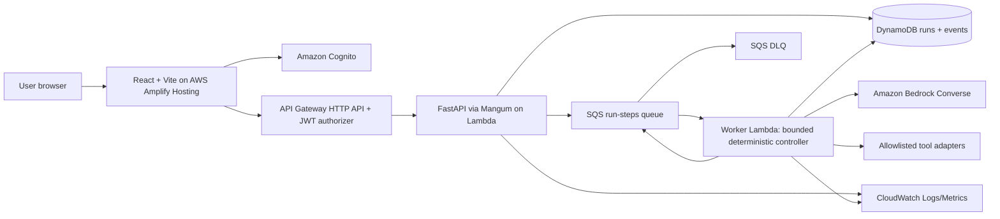

# ReAct Agent Workbench — Product Requirements & Technical Design

**Status:** Implementation-ready v1.0  
**Target:** Portfolio-quality AWS-deployed demonstration of bounded, observable, safe agentic execution  
**Interpretation:** ReAct = Reason + Act agent pattern; React = TypeScript user interface. Both are in scope.

## 1. Executive brief

Build a web application in which a user submits a practical research/planning question, watches an AI agent choose among allowlisted tools, sees evidence-bearing actions and observations, and receives a grounded final response. Unlike a basic chatbot, this system enforces finite execution, budgets, tool permissions, retries, and explicit termination reasons. The product is **ReAct Agent Workbench**.

**Business problem:** Agentic workflows can loop, call inappropriate tools, silently fail, fabricate evidence, and consume unpredictable tokens. Teams require repeatable executions with understandable controls and traceability.

**Success proposition:** A user can demonstrate a complete task with evidence, see the number of tool actions and cost estimate, and reproduce safe termination for normal, unsupported, failing-tool, and iteration-limit scenarios.

**Positioning:** A production-oriented agent execution-control product, not a generic chat demo, AI swarm, or blanket claim of hallucination elimination.

## 2. Users and jobs-to-be-done

1. **AI product owner:** Understand task completion, success rate, cost, and termination reasons.
2. **AI/platform engineer:** Diagnose steps, tool failures, retries, state transitions, and concurrency.
3. **Security reviewer:** Verify allowlisted tools, least-privilege execution, and auditability.

## 3. MVP scope

### In scope
- React/TypeScript dashboard: task form, tool allowlist, max steps, token budget, task status, final answer, evidence/action timeline, run analytics.
- AWS Bedrock Converse tool calling through a **configurable, confirmed-access model ID or inference profile**; no hard-coded claim of model access.
- A **deterministic execution controller** with `OBSERVE → DECIDE → VALIDATE → ACT → RECORD → REPEAT / FINISH` transitions. Model recommends actions; controller authorizes them.
- Tools: **safe calculator**, **curated knowledge lookup**, and **AWS service catalog lookup**. At least one real external dependency is optional later; no unrestricted internet or shell access in MVP.
- DynamoDB durable run state and immutable-per-sequence events with request IDs and source references.
- SQS asynchronous work queue, SQS dead-letter queue, worker Lambda, API Lambda, API Gateway, and CloudWatch logging/metrics.
- Cognito authenticated access; run ownership verified on all reads/updates. Single-tenant demo environment acceptable with authenticated users.
- Explicit `DONE`, `STEP_LIMIT`, `BUDGET_EXCEEDED`, `UNSUPPORTED`, `TOOL_FAILED`, `TIMEOUT`, `CANCELLED`, `SYSTEM_ERROR` termination codes.
- User cancellation, fixed limits, retries with bounded backoff, stale-run recovery, idempotent advancement.
- Unit, integration, evaluation, security, and smoke tests; reproducible deployment scripts; infrastructure as code.
- Honest mock mode for local UI demonstrations, prominently labeled and never presented as real Bedrock inference.

### Explicitly out of scope for v1
General web browsing, agent-created code/shell execution, arbitrary external plug-ins, multiple debating agents, persistent conversational memory, vector RAG, self-modifying prompts, production customer-data processing, enterprise SOC2 claims, Databricks/MLflow integrations, and speculative “40–60% cost savings.” Those are separate projects or measured future enhancements.

## 4. User experience

**Pages:** (1) Dashboard/recent runs, (2) New Run form, (3) Run Detail with event timeline and evidence, (4) Evaluation Results, (5) Settings/About methodology.

**Happy path:** User selects an example task (e.g., “Compare when to use SQS vs EventBridge for a small event-driven job, and calculate how many messages are processed at 12/sec over 5 min”), chooses allowed tools, starts run. UI immediately displays `QUEUED` and then polls every 2–3 seconds, shows visible observations/tool outcomes, and ends in a concise evidence-backed answer with a termination reason and usage metrics. Include 3 seeded scenarios: success, deliberate failing tool, and step-limit.

**Visibility rule:** Do not show hidden/private chain-of-thought or claim access to internal model reasoning. Display brief **action summaries**, validated tool arguments, returned observations, state changes, and final answer. Redact sensitive content in logs.

## 5. Functional requirements

| ID | Requirement | Acceptance test |
|---|---|---|
| FR-01 | Authenticate user via Cognito JWT | Unauthenticated calls get 401; cross-user run read returns 403/404 |
| FR-02 | Create a run with validated task and settings | `POST /runs` returns `202`, stable run ID, `QUEUED` |
| FR-03 | Execute model decisions via Bedrock Converse tool calls | Model tool request is schema-validated, allowlisted, and traced |
| FR-04 | Enforce hard step limit (default 6, max 10) | No more than configured action/decision iterations |
| FR-05 | Enforce token and wall-time budgets | Exceeding either terminates with explicit code |
| FR-06 | Only allow declared tools; never exec arbitrary code | Forged/unknown tool request rejected and logged |
| FR-07 | Retry transient failures only | Permanent failures fail safely; bounded exponential backoff |
| FR-08 | Persist monotonic run events and final state | Run survives worker restart; no double-execution from duplicate SQS deliveries |
| FR-09 | Display timeline, evidence, source IDs, token usage, and estimated cost | Dashboard and run detail render consistent totals |
| FR-10 | Permit cancellation | Pending or next-step execution respects cancellation flag |
| FR-11 | Evaluate scenarios | `make eval` produces JSON report and pass/fail summary |
| FR-12 | Deploy using IaC + GitHub CI | Documented commands, least-privilege roles, CI quality gates |

## 6. Non-functional requirements / SLO targets

- **Correctness:** 100% of synthetic infinite-loop test cases terminate by configured limit; 100% of unknown-tool calls rejected; 100% of run ownership checks enforced in integration tests.
- **Durability:** At-least-once messages with conditional-write idempotency. Never claim exactly-once distributed execution.
- **Availability:** No numerical uptime guarantee for portfolio demo. Operational target: documented error alerts and DLQ monitoring.
- **Latency:** Queue-to-first-step p95 < 30s under low-load test conditions; report measured outcome, not assumed result.
- **Security:** HTTPS, scoped IAM policies, encryption at rest by AWS-managed defaults or CMKs if justified, Cognito authorizer, no secrets in code, no unbounded user input in model prompts.
- **Limits:** Input 4,000 characters; max 10 steps; max 3 tool calls per step; max 60s per tool; max 5min per run; fixed concurrency limit; configurable Bedrock token budget.
- **Cost:** Per-run token usage and estimated inference spend; estimates depend on model/region/pricing configuration and must be labeled estimated. Add CloudWatch and AWS Budgets cost monitoring recommendations.

## 7. System architecture

**Design choices:** API Gateway HTTP API + Lambda for low-ops API; SQS permits asynchronous steps past an HTTP request timeout; DynamoDB conditional updates make repeated deliveries safe. AWS Amplify Hosting builds/deploys the React SPA. AWS CDK v2 TypeScript creates infrastructure; no manually created production resources. This is a portfolio architecture, not a promise that every service is free.

### Controller protocol
1. Validate run ownership, cancellation, lease/lock, TTL and budget.
2. Acquire a conditional run lease with unique `step_execution_id` and expiration. If lease is active, acknowledge duplicate without model invocation.
3. Read compact previous observations; construct bounded prompt and allowlist schema.
4. Call Bedrock Converse using selected model/inference profile; capture invocation metadata/token usage.
5. Validate response: either final answer with evidence refs or permitted tool calls. Apply JSON schema, argument size, count and semantic checks.
6. Call tools using **non-executable** adapters with timeouts. Return structured observations with stable source IDs.
7. Atomically record events/state transition conditional on version and lease; update usage and termination criteria. Emit next message only if not terminal; implement recovery for commit-before-enqueue windows using status/next-action outbox field and scheduled sweeper or explicit enqueue reconciliation.
8. When terminal, persist final answer or meaningful fallback. Never claim unsupported research is verified.

**At-least-once caveat:** A Lambda could crash after a non-idempotent tool action but before committing. MVP tools are read-only/pure. Future write tools need idempotency keys and explicit approval.

### Controller state
`QUEUED -> RUNNING -> (SUCCEEDED | FAILED | LIMIT_REACHED | CANCELLED)`. Each state has structured `termination_code`. `RUNNING` is not itself evidence that work advanced.

**End conditions:** final response; exhausted steps; exceeded tokens; elapsed time; repeated identical tool calls without new evidence (e.g. 2 repeated signatures); unsupported request; tool failure threshold; cancellation.

## 8. Data model

**DynamoDB `Runs` table** PK `USER#`, SK `RUN#<ulid>`; run item includes `run_id`, `owner_sub`, `task`, `status`, `termination_code`, `model_id`, `allowlisted_tools`, `max_steps`, `step_count`, `token_budget`, `input_tokens`, `output_tokens`, `estimated_usd`, `created_at`, `updated_at`, `expires_at`, `lease_owner`, `lease_expires_at`, `version`, `pending_enqueue`, `final_answer`. For efficient worker lookups by run ID use a securely scoped run ID index or separate metadata table (do not scan).

**DynamoDB `Events` table** PK `RUN#<ulid>`, SK `EVT#<zero-padded-sequence>`. Include `event_type`, `step`, `timestamp`, `tool_name`, `sanitized_args`, `observation`, `source_refs`, `error_code`, `token_usage`, `latency_ms`, `correlation_id`. Protect access by verifying run owner before querying events.

**Seeded knowledge** stored as version-controlled JSON shipped with worker (`id`, `title`, `text`, `source_type`, `version`); lookup does deterministic substring/keyword matching with documented limitations. AWS catalog facts should be sourced/curated and labeled as seed data, not live authoritative AWS lookup.

DynamoDB TTL is a **cleanup mechanism**, not a precise run timeout. Enforce run deadline in controller logic.

## 9. API contract

| Method | Route | Purpose |
|---|---|---|
| GET | `/healthz` | Liveness (no secrets) |
| GET | `/config` | Safe UI config, available tools, supported limits |
| POST | `/runs` | Create, enqueue run, returns 202 |
| GET | `/runs?limit=20` | Owner-scoped paginated recent runs |
| GET | `/runs/{run_id}` | Owner-scoped run detail |
| GET | `/runs/{run_id}/events?cursor=...` | Ordered, paginated trace |
| POST | `/runs/{run_id}/cancel` | Request cancellation, idempotent |
| GET | `/evals/latest` | Static/public-safe evaluation summary or authenticated scoped results |

Payload `POST /runs`: `{"task":"...","model_id":"<approved configured ID>","max_steps":6,"token_budget":8000,"allowed_tools":["calculator","knowledge_lookup","aws_service_catalog"]}`. Validate server-side. `202`: `{"run_id":"...","status":"QUEUED"}`. Error model `{ "code": "VALIDATION_ERROR", "message": "...", "request_id": "..." }`.

## 10. Technology stack

| Layer | Choice | Rationale |
|---|---|---|
| Frontend | React 19, TypeScript, Vite, Tailwind, TanStack Query, React Router, Recharts | Responsive typed SPA and operational views |
| Backend | Python 3.12+, FastAPI, Pydantic v2, Mangum | Typed HTTP APIs on Lambda |
| Agent | Explicit Python ReAct controller; **optional** LangGraph adapter only if value demonstrable | Finite deterministic control, easy evals, avoid gratuitous frameworks |
| Model | Amazon Bedrock Converse via boto3 | AWS-native configurable model invocation/tool calling |
| State | DynamoDB, conditional writes | Durable state, deduplication, event timelines |
| Queue | SQS + DLQ, event source mapping | Asynchronous execution/retry |
| Identity | Amazon Cognito, API Gateway JWT authorizer | Demo authentication and ownership |
| Ops | CloudWatch and structured JSON logs | Run monitoring and incident triage |
| IaC | AWS CDK v2 TypeScript | Repeatable deploy and destroy |
| CI | GitHub Actions + AWS OIDC | Tests and short-lived deploy credentials |
| Hosting | Amplify Hosting | Managed React SPA hosting |

**Frontend styling:** professional execution console. Visual hierarchy: Task composer → status + controls → action trace → evidence → metrics. Accessible keyboard interaction, empty/error/loading states, mobile layout. No decorative fake numbers.

## 11. Observability and analytics

Log `run_id`, correlation ID, step, transition, tool, duration, token counts, error type and sanitized args. Avoid raw secrets/user PII. Emit metrics: created runs, terminal success/error/limit distribution, mean/p95 steps, Bedrock invocation errors, dead-letter count, run age, average estimated cost per terminal run. Dashboard shows real values read from API; evaluation page labels local fixture metrics as tests.

**Quality indicators:** task completion rate, grounded answer rate, unsupported-claim rate on curated fixtures, steps/run, timeout rate, tool failure recovery, token spend per successful run. Define evidence criteria: answer claims referring to curated docs must cite valid IDs present in observed tool results. A source citation is not proof of correctness absent independent evaluation.

## 12. Evaluation plan

Maintain at least **25 JSONL fixtures** across:
- 8 normal multi-step tasks requiring lookup + calculation;
- 5 unsupported/insufficient-evidence tasks;
- 4 repeat-loop and step-limit simulations;
- 4 tool failure/transient retry/idempotency cases;
- 4 injection/unauthorized-tool/cross-user isolation cases.

Tests include deterministic fake Bedrock adapter (CI zero cloud cost), `pytest` property/invariant tests, frontend Vitest + React Testing Library, Playwright smoke, IaC snapshot/assertion tests, and optional real-Bedrock nightly/manual eval behind explicit flag. Never fabricate performance statistics. Eval CLI exports `results.json`, `summary.md` with denominators, model ID, region and timestamp.

## 13. Infrastructure and deployment

### Environments
`local` with mock Bedrock and local fixtures; `dev` AWS with deliberate small concurrency; `prod-demo` optional after tests. Configure region as variable (`AWS_REGION`) and verify chosen model availability and Bedrock invocation permissions **before** attempting cloud evaluation. Cloud deployment may incur charges.

### Suggested CDK resources
- Cognito user pool/app client (no client secret for SPA), test user created out-of-band safely.
- API Gateway HTTP API JWT authorizer; two Python Lambdas (API and worker).
- SQS queue with DLQ and `maxReceiveCount`, worker event-source batch size 1 initially, partial batch response, visibility timeout longer than worker timeout.
- DynamoDB Runs/Events tables with on-demand capacity, PITR option per environment, encryption, TTL for retention.
- CloudWatch log groups, DLQ depth alarm and worker error alarm.
- IAM least privilege (API: scoped DDB + SQS SendMessage; worker: DDB + SQS SendMessage + explicit Bedrock InvokeModel resource permissions; no admin or wildcard actions where avoidable).
- Amplify frontend as a documented Git connection step or CDK-hosted static fallback using S3/CloudFront; choose one main path and do not silently claim CLI created the Git-hosted Amplify connection.
- No NAT Gateway by default. Keep Lambdas outside VPC where sufficient to avoid unnecessary costs. Protect API with JWT.

### CI/CD
Pull request: lint, typecheck, unit/integration/eval tests, CDK synth. Protected main: deploy only with approved GitHub environment and AWS OIDC role; no long-lived access keys. Document setup of OIDC trust and required repository claims.

### Developer commands (to be implemented by Copilot)
`make setup`, `make dev`, `make test`, `make eval`, `make lint`, `make synth`, `make deploy-dev`, `make smoke`, `make destroy-dev`. All Make targets must actually exist and produce meaningful results.

## 14. Staged delivery

**Gate 1 – vertical slice:** React form → API → queued run → fake Bedrock → tool execution → DynamoDB traces → final UI. No real AWS yet; deterministic local harness.

**Gate 2 – agent correctness:** Bedrock adapter, allowlist, iteration/token/time/repeat limits, lease/idempotency, cancellation, fallback semantics.

**Gate 3 – AWS infrastructure:** CDK deploy of secure API, SQS, DynamoDB, Lambda, auth; Amplify frontend deployment; proven smoke test.

**Gate 4 – portfolio evidence:** 25+ fixtures, reproducible benchmark, cost and failure-path dashboard, README architecture/decision tradeoffs, 3-minute demo script, screenshots and honest limitations.

## 15. Definition of done

- A real AWS URL for frontend and authenticated API, both recorded in deployment outputs/documentation.
- A run executes on Bedrock with an accessible model, one or more real validated tool calls, persistent trace, and terminal status.
- Induced infinite loop ends within max steps; simulated duplicate message does not double-charge/tool-execute when lease active; unknown tool rejected; another user cannot access a run.
- Unit/integration/eval/CI checks pass; infrastructure synthesized and successfully deployed in user's own account.
- README starts with business problem and measurable success criteria, includes diagram, setup, cost/limits, threat model, evaluation, screenshots, failure case and trade-offs.
- No placeholder pages/handlers advertised as implemented; failed or missing cloud prerequisites explicitly reported.

## 16. Risks and decisions

1. **Model/tool compatibility:** Specific models, inference profiles and regional Bedrock access differ; validate chosen model's Converse tool support at deployment.
2. **Idempotency:** SQS offers at least once; pair lease + versioned commit + outbox reconciliation. Restricted MVP tools are intentionally read-only.
3. **Cost:** Bedrock and AWS services incur variable charges. Add max spend controls in app and external AWS Budgets alerts; app token caps cannot guarantee account-wide spend ceilings.
4. **Security:** Tool content can contain prompt injection. Treat retrieved content as untrusted data, never system instructions.
5. **UI trust:** Never present action summaries as raw model thoughts and never present mock output as real tool evidence.

## 17. Primary documentation

- Amazon Bedrock Converse API: https://docs.aws.amazon.com/bedrock/latest/APIReference/API_runtime_Converse.html
- Bedrock inference/tool use: https://docs.aws.amazon.com/bedrock/latest/userguide/conversation-inference.html
- AWS Amplify Hosting: https://docs.aws.amazon.com/amplify/latest/userguide/welcome.html
- AWS CDK v2 Lambda/ECS general infrastructure guide: https://docs.aws.amazon.com/cdk/v2/guide/home.html
- SQS with Lambda: https://docs.aws.amazon.com/lambda/latest/dg/with-sqs.html
- API Gateway HTTP API JWT: https://docs.aws.amazon.com/apigateway/latest/developerguide/http-api-jwt-authorizer.html
