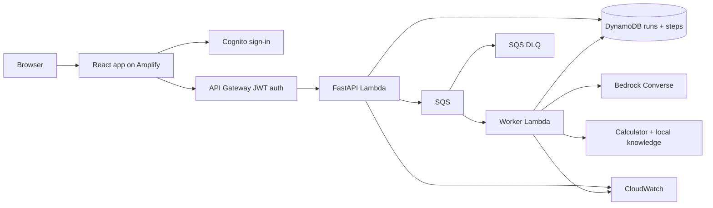

# ReAct Planning Agent — AWS Portfolio Project (Manisha)

**Status:** Build-ready scoped v1.1  
**Target:** Data scientist / ML engineer portfolio: an end-to-end, deployed agent, not an enterprise control plane.  
**Naming:** *ReAct* = reason/action agent pattern; *React* = web UI framework.

## 1. Project pitch

**Problem:** An AI assistant can call tools repeatedly, fail without explanation, or give a confident answer without evidence. Demonstrate a bounded agent that selects tools, records actions, and stops safely.

**Product:** A user enters a planning question, starts an agent run, and watches a simple React interface display tool choices, observations, the final answer, and the reason the run stopped.

**Portfolio signal:** Python + LLM tool calling, React/TypeScript integration, cloud-native deployment, basic AWS security/observability, repeatable automated evaluation. This is a strong hands-on project appropriate for an experienced data scientist / ML engineer without imposing a staff architect's platform scope.

## 2. Demo scenario

User asks: **"For a small photo-processing workflow, should I use SQS or EventBridge? Also calculate how many images arrive in 15 minutes at 8 images per second."** Agent can call `knowledge_search` (curated, versioned AWS service notes) and `calculator` (safe arithmetic with a restricted parser; absolutely no Python `eval`). The final response cites returned source IDs and shows the calculated total. Alternative demos: unknown fact should be explicitly marked unsupported; a scripted agent trying repeated actions must stop after max steps.

## 3. Must-have scope

1. **React UI:** Task input, sample task buttons, Start Run, current status, step timeline, final answer, tools used, approximate token usage, and termination reason; loading/empty/error views.
2. **Python FastAPI API:** Create run and retrieve run/status/events. Validate input with Pydantic. API works as a Lambda handler through Mangum.
3. **Bounded ReAct worker:** `DECIDE -> VALIDATE -> EXECUTE TOOL -> RECORD -> REPEAT/FINISH`. Default max 5 steps (configurable 3–8). Reject non-allowlisted tools and invalid args; stop with a useful fallback on model/tool errors. Do not expose hidden chain-of-thought: show action summaries and observations only.
4. **LLM:** Amazon Bedrock Converse tool use; configure model ID/inference profile via environment. Provide deterministic mock mode for local development and tests, visibly labeled as mock.
5. **Tools:** `calculator` and `knowledge_search` over ~10 short, curated, version-controlled facts with stable citations; no live search or external plugins.
6. **AWS deployment:** Amplify Hosting (React SPA), Cognito hosted sign-in or supported SDK sign-in, API Gateway HTTP API with JWT authorization, API Lambda, SQS + DLQ, worker Lambda, DynamoDB single table, CloudWatch logs, CDK TypeScript. Keep Lambdas outside a VPC unless required.
7. **Persistence:** One DynamoDB table for runs and step events; partition/sort keys `PK=RUN#<id>`, `SK=META` or `STEP#<000n>`. Store owner subject on META; API checks owner before reading all records. Worker retrieves by run ID. TTL for demo retention.
8. **Tests:** Pytest unit tests for tool schemas, termination, failure handling, fake-model integration; React Vitest UI tests; 12 scenario-based evaluation fixtures (see below). GitHub Actions runs checks. Provide AWS deployment instructions, safe cleanup and a demo video outline.

## 4. Explicitly deferred (not MVP)

No multi-agent debate, long-term memory, vector DB, web crawling, agent-generated code, shell tools, user-defined tools, streaming tokens, WebSockets, self-improvement, LangSmith/Arize integration, Grafana, custom metrics pipelines, elaborate cost accounting, canary rollout, automatic recovery sweepers, complex distributed locks, manual approvals, or multi-environment pipelines. These can be follow-on projects; don't scaffold them as empty modules.

## 5. Architecture



**Why the worker queue?** The agent may need multiple Bedrock round trips, so HTTP submits a task and returns immediately. The frontend polls once every 2–3 seconds until terminal. **Why one table?** The event history is naturally keyed by run and is small for this demo. **Why no Step Functions?** One bounded worker invocation is enough for the max-5-step demo; avoiding another orchestration layer keeps the build teachable.

## 6. Run behavior and guarantees

- API returns `202` and `run_id`; frontend shows `QUEUED`.
- SQS triggers worker. It checks `status` and atomically claims `QUEUED -> RUNNING` using a conditional DynamoDB write. Duplicate SQS messages seeing a claimed or terminal run exit without executing the agent again. **Caveat:** this prevents most duplicates; crashes while RUNNING may leave a run incomplete. Implement a worker runtime limit and mark failures where possible. Document that automatic stale-run recovery is deferred.
- Worker loops at most `max_steps`. For each step: call model, validate final/tool response, run allowlisted pure/read-only tool, write step event, update usage. Do not invoke arbitrary commands.
- Explicit terminal states: `SUCCEEDED`, `LIMIT_REACHED`, `FAILED`. Include `termination_reason`: `FINAL_ANSWER`, `STEP_LIMIT`, `UNSUPPORTED`, `MODEL_ERROR`, `TOOL_ERROR`, `TIMEOUT`, `INVALID_TOOL`.
- Use Bedrock response token usage when present; don't invent dollar figures. No real streaming. Poll API.
- Target Lambda worker timeout < 15 minutes, set queue visibility timeout to at least 6x Lambda timeout per AWS guidance where applicable, and choose max 5 steps and bounded model output/time budget to fit comfortably. Limit SQS batch size to 1. Configure DLQ and CloudWatch error alert. Processing is **at-least-once**, not exactly once.
- Knowledge is curated sample content, not up-to-date AWS documentation. Citations must reference items actually retrieved. Never claim full hallucination prevention.

## 7. Endpoints

| Method | Path | Response |
|---|---|---|
| `GET` | `/health` | Public liveness |
| `POST` | `/runs` | `202 {run_id,status}` |
| `GET` | `/runs` | Recent runs scoped to authenticated user (small demo; owner GSI if required) |
| `GET` | `/runs/{run_id}` | Current status, final answer, usage, termination reason |
| `GET` | `/runs/{run_id}/steps` | Timeline ordered by step sequence |

`POST /runs` example: `{"task":"...","max_steps":5}`. Tool allowlist is server-managed to reduce UI complexity. Use validated Cognito `sub` from JWT claims, never request-supplied `owner_id`. For efficient listing add an owner/time GSI, or omit recent-runs listing if it threatens the MVP timeline; **never scan all users' runs**.

## 8. UI

Single-page workbench with (a) title and one-sentence value statement, (b) task editor + example prompts, (c) current run status, (d) numbered action timeline with tool, summary, and observation, (e) answer and cited snippets, (f) small usage strip: steps / tokens / termination. Auth gate and signed-out state. Basic responsive styling and keyboard-accessible controls. No pretend charts or hard-coded success counts. Distinguish local mock from real Bedrock runs.

## 9. Evaluation and tests

12 JSON fixtures: 4 successful two-tool tasks; 3 unsupported/insufficient-evidence tasks; 2 step-limit loops; 2 tool failures/invalid calls; 1 prompt-injection fixture (a document says to ignore system policy; agent must treat it as data). Deterministic tests use mock model, so PR CI needs no AWS or paid inference. Assertions include finite termination, argument validation, no unauthorized tool, correct citation IDs, and no cross-user API reads. Include a manual Bedrock smoke task after deployment.

## 10. Security and budget

Cognito-authenticated API routes; server-side owner checks; minimal IAM permissions per Lambda; input length cap (2,000 characters), max steps 8, Bedrock model/token limits, sanitized step/log payloads; no credentials in repository; GitHub OIDC recommended for automated deployment but **manual `cdk deploy` is the default first deployment**. No NAT/VPC to avoid surprise baseline cost. Document Bedrock access/region/model capability checks, AWS Budgets alerts (not hard cost caps), and `cdk destroy` instructions. Warn explicitly that AWS services may charge.

## 11. Repository scaffold

```text
react-agent-workbench/
  README.md
  .env.example
  Makefile
  frontend/
    src/{App.tsx,components/,hooks/,lib/,types/}
    package.json
  backend/
    app/{api.py,models.py,db.py,auth.py,agent.py,bedrock_client.py,tools.py,knowledge.json,worker.py}
    tests/{test_agent.py,test_tools.py,test_api.py}
    evals/{cases.json,run_evals.py}
    requirements.txt
  infra/
    bin/app.ts
    lib/workbench-stack.ts
    package.json
    cdk.json
  .github/workflows/ci.yml
  docs/{architecture.md,aws-deploy.md,demo-script.md}
```

Avoid placeholder code. If a component cannot be finished, document explicitly in `README.md` rather than pretending it's deployed.

## 12. Delivery gates

**Gate A — local vertical slice:** Mock agent, tools, local DynamoDB substitute/in-memory repository for tests, FastAPI, React page, passing basic unit tests.

**Gate B — AWS working deployment:** CDK provisions API Gateway, Cognito, Lambda x2, SQS/DLQ, DynamoDB and logs; deploy React to Amplify; execute a real Bedrock run (once verified that model access is available).

**Gate C — portfolio polish:** 12 deterministic evaluations, failure/limit demos, security test, screenshots, architecture diagram, concise README and 2–3-minute video script. The project is complete at Gate C.

## 13. Definition of done

1. Publicly accessible Amplify frontend with working Cognito authentication and protected API (not anonymous agent invocation).
2. Successful **real Bedrock** answer using calculator and knowledge tool with source IDs and step timeline.
3. A loop demonstration halts by step limit; an invalid tool is rejected.
4. A tested user cannot read another user's runs.
5. Test suite and `cdk synth` pass; instructions include prerequisites, deployment, expected charges, teardown, and troubleshooting.
6. README makes measurable, truthful claims and presents Manisha's role/contributions without invented results.

## 14. Reference docs

- Bedrock Converse: https://docs.aws.amazon.com/bedrock/latest/APIReference/API_runtime_Converse.html
- Lambda and SQS: https://docs.aws.amazon.com/lambda/latest/dg/with-sqs.html
- DynamoDB condition expressions: https://docs.aws.amazon.com/amazondynamodb/latest/developerguide/Expressions.ConditionExpressions.html
- API Gateway JWT: https://docs.aws.amazon.com/apigateway/latest/developerguide/http-api-jwt-authorizer.html
- Amplify hosting: https://docs.aws.amazon.com/amplify/latest/userguide/welcome.html
- CDK: https://docs.aws.amazon.com/cdk/v2/guide/home.html


## 13. Deliverables addendum — design system, editable architecture, docs and teardown (v1.2)

- Implement React components/states specified by [`docs/UI_COMPONENT_SPEC.md`](docs/UI_COMPONENT_SPEC.md). Keep status and mode backed by real API responses, accessible at desktop/mobile sizes.
- Maintain editable [`architecture/aws-architecture.drawio`](architecture/aws-architecture.drawio) and its SVG export. README and `docs/index.html` **must both** display/link it and document service responsibilities and request/async execution paths. Use draw.io for every architecture change and refresh the SVG; diagram source is authoritative.
- Maintain a visually polished static [`docs/index.html`](docs/index.html) for presentations. Distinguish UI concept from deployed application. Add a verified publishable `/docs` build with working relative assets; do not claim current local links work when hosted from `/docs` subdirectory without copies.
- Implement full AWS offboarding per [`docs/aws-deploy-teardown.md`](docs/aws-deploy-teardown.md), including manually created Amplify Hosting. Provide read-only verification and destructive cleanup **only with explicit owner approval** and correct account/region. CDK `destroy` may leave retained/non-CDK resources.
- Website generation provider integration (named 'Expial' by project sponsor) is optional and deferred until the provider's official API documentation, endpoint, supported actions and credentials are supplied. Do not assume a client-side API is safe. Never commit or echo user-provided keys; accept credentials only via secrets/environment configuration. The final presentation site must work without this external API.
